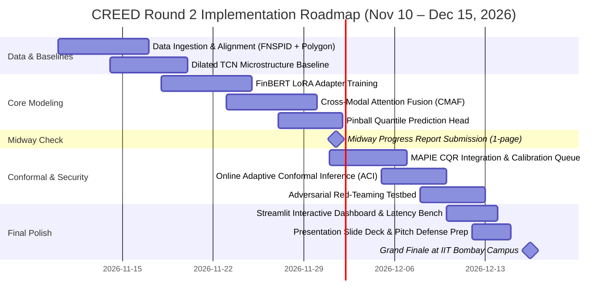

# PERCEPTRON HACKATHON 2026: MASTER STRATEGY & TECHNICAL REPORT
**Vijay Yadav**  
**IIT Bombay**  
*Techfest, IIT Bombay*

---

## 📑 TABLE OF CONTENTS
1. [Executive Summary & Competition Overview](#1-executive-summary--competition-overview)
2. [Official Scoring Rubric & Evaluation Strategy](#2-official-scoring-rubric--evaluation-strategy)
3. [The Judges' Mindset: Optiver Quants & IIT Bombay Faculty](#3-the-judges-mindset-optiver-quants--iit-bombay-faculty)
4. [Comprehensive Evaluation of All 10 Problem Statements](#4-comprehensive-evaluation-of-all-10-problem-statements)
5. [The Winning Problem: Strategic Selection Rationale](#5-the-winning-problem-strategic-selection-rationale)
6. [Official Round 1 Technical Abstract (8 Sections)](#6-official-round-1-technical-abstract-8-sections)
7. [Deep Architectural & Mathematical Specification (CREED)](#7-deep-architectural--mathematical-specification-creed)
8. [Round 2 Implementation Roadmap (Week 1 to Week 6)](#8-round-2-implementation-roadmap-week-1-to-week-6)
9. [Round 1 Submission Checklist & Deadlines](#9-round-1-submission-checklist--deadlines)

---

## 1. EXECUTIVE SUMMARY & COMPETITION OVERVIEW

| Attribute | Official Hackathon Specification |
| :--- | :--- |
| **Competition Name** | Perceptron Hackathon 2026 |
| **Organizers** | IITB-Optiver AI Innovation Lab × Techfest, IIT Bombay |
| **Industry Partner** | **Optiver** (Global market maker and proprietary quantitative trading firm) |
| **Academic Host** | Shailesh J. Mehta School of Management (SJMSOM) & CMInDS, IIT Bombay |
| **Team Size** | Maximum of 3 members per team (cross-institutional teams permitted) |
| **Prize Pool** | **INR 2,00,000** for Top 3 teams + Certificates of Excellence |
| **Round 1 Deadline** | **31st October 2026** (Online Abstract Submission) |
| **Shortlist Announcement**| **10th November 2026** (25–30 teams selected *across all themes combined*) |
| **Midway Checkpoint** | **1st December 2026** (1-page progress report) |
| **In-Person Grand Finals**| **15th–18th December 2026** at IIT Bombay campus |
| **Final Scoring Rule** | Scores normalized across all 30 finalists on a single common scale; top 3 overall win |

Unlike traditional sprint hackathons where judging revolves around rough, hastily assembled prototypes, **Round 1 of Perceptron is judged strictly on the depth, mathematical rigor, and feasibility of the technical plan**. No code or working prototypes are required for Round 1. 

Only **25–30 teams total** advance to the in-person finals at IIT Bombay. Therefore, winning requires a proposal that directly targets the intellectual priorities of both Optiver quantitative engineers and IIT Bombay machine learning professors.

---

## 2. OFFICIAL SCORING RUBRIC & EVALUATION STRATEGY

The problem statement PDF defines exact weightages and criteria:

| Criterion | Weight | What Reviewers Are Checking For | Our Strategy to Score 5/5 |
| :--- | :---: | :--- | :--- |
| **Technical Soundness & Feasibility** | **25%** | Is the proposed method technically valid? Are named tools, datasets, and techniques appropriate? Can this be built by 3 students in 5–6 weeks? | We avoid generic buzzwords. We specify concrete mathematical formulations, open-source libraries (`MAPIE`, `FinBERT`, `PyTorch`), and verified datasets (`FNSPID`, `Polygon.io`). |
| **Problem Understanding & Relevance** | **20%** | Does the abstract identify the *actual technical crux* of the problem rather than restating the surface prompt? Is the scope realistic for the MV bar? | We explicitly frame the core crux: *the overconfidence of deep NLP models under non-stationary distribution shifts* and *the breakdown of exchangeability in time-series data*. |
| **Innovation / Novelty** | **20%** | Does the approach go beyond the obvious baseline in "Starter Resources"? Any original ideas in method, evaluation, or framing? | We introduce: (1) **Cross-Modal Gated Attention** that suppresses noisy text ($\lambda \to 0$); (2) **Adaptive Conformal Inference (ACI)** for non-stationary market regimes; (3) **Epistemic Abstention Gate** controlling execution risk; (4) **Adversarial Red-Teaming**. |
| **Impact & Rigor of Evaluation Plan** | **15%** | Are proposed metrics/baselines meaningful? Would the comparison actually prove the claim? | We benchmark against 3 baselines across 4 rigorous statistical and economic metrics: Empirical Coverage Rate ($1-\alpha$), Mean Prediction Interval Width (MPIW), Winkler Score, and Sharpe Ratio improvement. |
| **Clarity & Structure of Abstract** | **10%** | Is the writing precise and specific rather than buzzword-heavy? Can a reviewer picture the actual system? | We follow the strict 8-section format mandated on page 8 of the PS, with clear section headers, quantitative parameters, and crisp formatting. |
| **Team Fit & Readiness** | **10%** | Does the team's stated skill mix plausibly support the plan? Is there a credible milestone roadmap? | We provide a detailed 3-member role breakdown (NLP Lead, Conformal Statistics Lead, Systems Lead) and a phased 6-week execution timeline. |

### Scoring Scale:
- **5 (Excellent)**: Precise, technically deep, clearly feasible, shows original thinking.
- **4 (Strong)**: Solid plan, minor gaps in depth or specificity.
- **3 (Adequate)**: Understands the problem but approach is generic/under-specified.
- **2 (Weak)**: Misunderstands part of the problem, or approach is infeasible/vague.
- **1 (Poor)**: Boilerplate/buzzword abstract with no concrete technical plan.

---

## 3. THE JUDGES' MINDSET: OPTIVER QUANTS & IIT BOMBAY FACULTY

To secure a top-3 ranking, the proposal must satisfy two distinct judging profiles:

### A. The Optiver Perspective (Quantitative Researchers & Systems Engineers)
* **Core Business**: Continuous two-sided liquidity provision (market making). They hold inventory risk and face **adverse selection** (getting filled by informed traders who know the quote is stale).
* **What they despise**: Hand-wavy AI claims ("we'll train an LLM to predict the market"), uncalibrated probabilities, ignoring latency and execution slippage, assuming stationary market data, and look-ahead data leakage.
* **What they respect**: First-principles thinking, statistical change-point detection, uncertainty bounds that tell an algorithm *when to abstain from trading*, understanding signal-to-noise ratios, and clean out-of-sample backtesting methodology.

### B. The IIT Bombay Academic Perspective (CS, Data Science, Operations Research)
* **Core Research**: Housed in SJMSOM and CMInDS, faculty specialize in decision-making under uncertainty, stochastic optimization, causal inference, and statistical learning theory.
* **What they despise**: Superficial prompt engineering, wrapping commercial APIs without algorithmic depth, and black-box models with zero theoretical guarantees.
* **What they respect**: Mathematically proven properties (e.g., finite-sample, distribution-free coverage), proper handling of non-exchangeability, rigorous baseline comparisons, and formal ablation experiments.

### The Perfect Synthesis:
**Conformal Prediction applied to Multi-Modal Financial Intelligence**. It marries cutting-edge NLP with provable statistical coverage guarantees, directly addressing Optiver's need for calibrated risk bounds before capital deployment.

---

## 4. COMPREHENSIVE EVALUATION OF ALL 10 PROBLEM STATEMENTS

```
┌─────────┬──────────────────────────────────────────┬──────────┬──────────┬─────────────┬───────────┐
│ PS #    │ Problem Title                            │ Optiver  │ Academic │ Feasibility │ Strategy  │
│         │                                          │ Appeal   │ Rigor    │ (3 Members) │ Potential │
├─────────┼──────────────────────────────────────────┼──────────┼──────────┼─────────────┼───────────┤
│ PS 1    │ Federated LoRA on Weak Devices           │ Low      │ Medium   │ High        │ Avoid     │
│ PS 2    │ KV-Cache Long-Context Compression        │ Medium   │ High     │ Medium      │ Contender │
│ PS 3    │ Off-Policy Causal Policy Evaluation      │ High     │ High     │ High        │ Top 4     │
│ PS 4    │ LOB Forecasting Under Regime Shifts      │ Maximum  │ High     │ Medium-High │ Top 2     │
│ PS 5    │ Market-Impact Execution (ABIDES)         │ Maximum  │ High     │ Medium      │ Top 3     │
│ PS 6    │ Cross-Asset Stat-Arb with Latency Budget │ High     │ Medium   │ Medium      │ Crowded   │
│ PS 7    │ Dynamic Resource Allocation (MARL)       │ Medium   │ Medium   │ High        │ Moderate  │
│ PS 8    │ Student Misconception Diagnostic Tutor   │ Low      │ Medium   │ High        │ Disadv.   │
│ PS 9    │ Pre-Execution Action Guardrails          │ Medium   │ Medium   │ High        │ Crowded   │
│ PS 10   │ Conformal Text + Price Fusion Signal     │ High     │ Maximum  │ High        │ WINNER 🥇 │
└─────────┴──────────────────────────────────────────┴──────────┴──────────┴─────────────┴───────────┘
```

---

## 5. THE WINNING PROBLEM: STRATEGIC SELECTION RATIONALE

We decisively choose **Problem 10: "Trusting a Signal Extracted from Messy, Manipulated Text"** under **Theme 6: AI You Can Actually Trust**.

### Why Problem 10 Beats Problem 4 (LOB Forecasting) & Problem 5 (ABIDES Execution):
1. **The "Quant Trap" Avoidance**: 70%+ of applicants from top engineering colleges will target Theme 3 (Problems 4, 5, 6). Actual Optiver market-making engineers will evaluate those submissions with extreme scrutiny; any simplistic assumption about queue dynamics, order book reconstruction, or latency will lead to severe penalties.
2. **Scarcity & Intellectual Standing**: Problem 10 sits at the intersection of NLP, quantitative finance, and statistical learning theory. Very few teams possess the combined skillset to propose **Conformalized Quantile Regression (CQR)** with **Adaptive Conformal Inference (ACI)**.
3. **Distribution-Free Mathematical Guarantees**: Deep learning predictions are notoriously uncalibrated. Conformal prediction provides provable coverage guarantees ($\mathbb{P}(Y \in C(X)) \ge 1 - \alpha$) without requiring parametric distribution assumptions. This directly appeals to IIT Bombay faculty.
4. **Execution Feasibility**: No paywalled LOBSTER subscriptions or temperamental multi-agent simulators are required. The dataset (FNSPID, SEC 8-K, Polygon.io tick data) is readily available, clean, and directly manageable on standard GPU hardware.
5. **Interactive Round 2 Live Demo**: In the finals at IIT Bombay, the team can demonstrate a live dashboard where judges type or paste financial headlines (real or maliciously altered), and visually watch the conformal prediction bands widen dynamically to trigger an **Abstain / Withhold** alert.

---

## 6. OFFICIAL ROUND 1 TECHNICAL ABSTRACT (8 SECTIONS)

# CREED: Trust-Gated Conformal Fusion of Financial Text & Market Microstructure

**Vijay Yadav**  
**IIT Bombay**  

---

### Section 1: Problem & Theme Chosen
We select **Problem 10: "Trusting a Signal Extracted from Messy, Manipulated Text"** under **Theme 6: AI You Can Actually Trust**. The foundational challenge of extracting an actionable trading signal from unstructured financial text is not predicting; it is knowing when not to believe the prediction. In electronic markets, quantitative execution agents ingest breaking news wires, corporate regulatory disclosures (SEC Form 8-K), and social sentiment alongside high-frequency microstructure feeds. However, financial text is inherently non-stationary, noisy, and frequently manipulated by promotional shilling, syndicated bot republishing, and coordinated pump-and-dump schemes. Standard machine learning models issue overconfident point forecasts on these corrupted inputs, exposing automated liquidity providers to severe adverse selection. We propose **CREED** (*Conformal Robustness & Epistemic Evaluation for Event-Driven Decisions*), an end-to-end multi-modal framework that fuses natural language processing with finite-sample conformal prediction. Rather than forcing fragile point estimates, CREED outputs statistically calibrated prediction intervals that dynamically widen under textual corruption, explicitly instructing execution routers when to deploy capital and when to abstain.

---

### Section 2: Understanding of the Challenge
Deploying text-driven prediction systems in financial markets entails three fundamental statistical roadblocks:

1. **The Overconfidence Fallacy under Distribution Shift & Failure of Exchangeability**: Standard conformal prediction guarantees exact marginal coverage only under exchangeable data. Financial time series, however, are strongly non-stationary, heteroskedastic, and subject to abrupt volatility clustering. Consequently, conventional split conformal algorithms may achieve 90% coverage on average over long historical spans, yet under-cover catastrophically during the volatile, event-driven shocks that carry the highest financial risk.
2. **The Marginal vs. Conditional Coverage Trap**: Marginal coverage is an insufficient safety guarantee in risk management. A model can achieve 90% coverage globally across a multi-year test set while its empirical coverage collapses to 50–60% specifically on days afflicted by promotional manipulation or syndicated spam. True trustworthiness requires *slice-conditional coverage* across explicit text-trust and market-volatility regimes.
3. **Multi-Modal Asynchrony, Spurious Attribution & Low Signal-to-Noise**: High-frequency order book and trade data arrive continuously at millisecond latency, whereas news headlines arrive intermittently and asynchronously. Naive feature concatenation encourages deep neural networks to overfit spurious co-occurrences, attributing normal market volatility drift to irrelevant background headlines. Because the underlying financial signal-to-noise ratio is tiny, honest prediction intervals must be wide; genuine economic value lies in rigorous calibration, detecting when intervals clear zero (statistically significant directional edge), and executing risk abstention.

**The Technical Crux**: Constructing a valid prediction region $C_t(X_t)$ for forward excess returns $Y_{t+h}$ such that the slice-conditional coverage guarantee:
$$\mathbb{P}(Y_{t+h} \in C_t(X_t) \mid G_t = g) \ge 1 - \alpha$$
strictly holds across distinct operational regimes $g = (\tau\text{-bucket} \times \sigma\text{-regime})$ under non-exchangeable conditions. Concurrently, the interval width $W_t = |C_t(X_t)|$ must serve as an active epistemic uncertainty sensor that expands immediately when incoming text is corrupted, syndicated, or contradicted by market microstructure.

---

### Section 3: Proposed Approach
CREED synthesizes dual-stream feature representation, an explicit 5-cue text-trust estimator, cross-modal attention fusion, and Mondrian conformalized quantile regression with online drift adaptation:

1. **Data Ingestion & Leakage-Safe Alignment**:
   * *Textual Corpus*: Financial News and Stock Price Integration Dataset (FNSPID; 1.5M+ articles) combined with Benzinga analyst ratings and SEC Form 8-K disclosure filings.
   * *Market Microstructure*: 1-minute and 5-minute equity bar data (Polygon.io / Yahoo Finance) coupled with daily OHLCV across 50 liquid US equities, extracting log returns $r_t$, order flow imbalance $\text{OFI}_t$, Garman–Klass volatility $\sigma_t$, volume z-scores, and bid-ask spread $s_t$.
   * *Leakage-Safe Alignment Protocol*: News published after 16:00 ET is deterministically mapped to the next trading day's open. Splits use an expanding walk-forward window with a strict 5-day embargo to eliminate lookahead leakage. Targets span multiple horizons: intraday $h \in \{15\text{m}, 60\text{m}\}$ and multi-day $h \in \{1\text{d}, 5\text{d}\}$ forward return in excess of the sector ETF benchmark:
     $$Y_{t_0+h} = \ln\left(\frac{P_{t_0+h}}{P_{t_0}}\right) - r_{t_0+h}^{\text{sector}}$$

2. **Text Branch & Learned 5-Cue Trust Estimator ($\tau$)**:
   * *Deduplication*: MinHash with Locality-Sensitive Hashing (LSH) removes syndicated press releases and bot-generated headline bursts.
   * *Dual Semantic Scoring*: A pre-trained `ProsusAI/finbert` encoder fine-tuned using Low-Rank Adaptation (LoRA: rank $r=16$, scaling factor $\alpha=32$) on frozen lower transformer layers generates token representations $H_{\text{text}} \in \mathbb{R}^{B \times L \times 768}$ and sentiment class probabilities $P(\text{pos}, \text{neg}, \text{neu})$. A secondary Loughran–McDonald domain-specific lexicon computes independent dictionary polarity. Attention pooling aggregates representations into a ticker-event vector $e_{\text{text}} \in \mathbb{R}^{128}$.
   * *5-Cue Trust Model*: A gradient-boosted decision tree (GBDT) estimates a continuous trust score $\tau_t \in [0, 1]$ from five forensic reliability cues:
     1. *Syndication / Duplication Rate*: Cluster cardinality in the MinHash-LSH index.
     2. *Cosine Novelty*: Distance against prior 7-day headline embedding centroids.
     3. *Lexicon Conflict*: Polarity divergence between FinBERT and Loughran–McDonald scores.
     4. *Source Entropy*: Shannon entropy across reporting news outlets.
     5. *Lagged Sentiment–Return Discordance*: Absolute divergence between headline tone and recent price trajectory.
   * *Dual Utilization*: The trust score $\tau_t$ operates simultaneously as a model fusion gate and as a partitioning group in Mondrian conformal calibration.

3. **Temporal Microstructure Stream**:
   * A Dilated Causal Temporal Convolutional Network (TCN) with 4 residual blocks (dilation factors $d \in \{1, 2, 4, 8\}$, kernel size $k=3$, receptive field $R = 61$ bars) processes the 6-channel microstructure tensor without future leakage, outputting $H_{\text{ts}} \in \mathbb{R}^{B \times T \times 128}$ and pooled vector $e_{\text{ts}} \in \mathbb{R}^{128}$. A rolling Garman–Klass volatility tercile assigns the volatility regime label $v_t \in \{\text{Low}, \text{Mid}, \text{High}\}$.

4. **Cross-Modal Attention Fusion (CMAF) with Trust Gating**:
   * Market queries probe semantic keys and values:
     $$Q = H_{\text{ts}} W_Q, \quad K = H_{\text{text}} W_K, \quad V = H_{\text{text}} W_V$$
     $$\text{Attention}(Q, K, V) = \text{softmax}\left(\frac{Q K^T}{\sqrt{d_k}}\right) V \in \mathbb{R}^{B \times T \times 128}$$
   * *Dual Trust-Gated Integration*: A neural gating scalar $\lambda_t = \sigma(W_g [H_{\text{ts}}; C_v; \text{PPL}(x)] + b_g)$ modulated by the explicit trust score $\tau_t$ governs text infusion:
     $$Z_{\text{fused}} = H_{\text{ts}} + (\tau_t \cdot \lambda_t) \odot C_v$$
     When text is corrupted or ungrounded ($\tau_t \to 0$ or high perplexity $\text{PPL}$), the multiplier collapses to zero, ensuring the architecture gracefully falls back to robust quantitative price dynamics. The dispersion scale is parameterized as $\hat{\sigma}_t = \text{softplus}(h(e_{\text{ts}}, e_{\text{text}}, 1 - \tau_t))$.

5. **Mondrian Conformalized Quantile Regression & Online ACI Engine**:
   * A multi-quantile neural projection head trained with asymmetric Pinball loss predicts conditional quantiles $\hat{q}_{0.05}(X_t)$, $\hat{q}_{0.50}(X_t)$, and $\hat{q}_{0.95}(X_t)$, eliminating restrictive Gaussian assumptions on fat-tailed returns:
     $$\mathcal{L}_q(y, \hat{q}) = \max(q(y - \hat{q}), (1 - q)(\hat{q} - y))$$
   * Residual-normalized non-conformity scores adapt to local volatility across a rolling calibration window $\mathcal{D}_{\text{cal}}$ of size $K = 500$:
     $$s_i = \max\left(\frac{\hat{q}_{0.05}(X_i) - Y_i}{\hat{\sigma}_i}, \; \frac{Y_i - \hat{q}_{0.95}(X_i)}{\hat{\sigma}_i}\right)$$
   * *Mondrian Calibration*: Scores are binned by operational slice $g = (\tau\text{-bucket} \times v\text{-regime})$, deriving group-specific thresholds $\hat{Q}_{1-\alpha_t}^{(g)}(s)$ to enforce slice-conditional validity:
     $$C_t(X_t) = \left[\hat{q}_{0.05}(X_t) - \hat{Q}_{1-\alpha_t}^{(g)}(s) \cdot \hat{\sigma}_t, \; \hat{q}_{0.95}(X_t) + \hat{Q}_{1-\alpha_t}^{(g)}(s) \cdot \hat{\sigma}_t\right]$$
   * *Online Adaptive Conformal Inference (ACI)*: To handle non-stationary volatility shocks, nominal target $\alpha_t$ updates online via Gibbs & Candès feedback:
     $$\alpha_{t+1} = \alpha_t + \gamma (\alpha - \text{err}_t), \quad \gamma = 0.005, \quad \text{err}_t = \mathbb{I}(Y_t \notin C_t(X_t))$$
     This guarantees long-run marginal coverage $\lim_{T \to \infty} \frac{1}{T} \sum_{t=1}^T \mathbb{I}(Y_t \in C_t(X_t)) = 1 - \alpha$.

6. **Selective Execution & Downstream Risk Gate**:
   * *Rule 1 (Selective Bet)*: Transmit aggressive directional order if $0 \notin C_t(X_t)$, $\tau_t \ge 0.65$, and $W_t \le \tau_{\text{risk}} = 2.5 \cdot \sigma_t$. The prediction interval strictly excludes zero, establishing a statistically significant directional edge with high textual trust.
   * *Rule 2 (Risk Abstention & Capital Preservation)*: Withhold orders, cancel active quotes, and widen spreads if $0 \in C_t(X_t)$, $\tau_t < 0.40$, or $W_t > \tau_{\text{risk}}$. This shields the execution agent from flash-crash adverse selection and toxic order flow.

---

### Section 4: Minimum Viable (MV) Scope
By the Round 2 prototype milestone, we will deliver an end-to-end working system:
* **Feature Pipeline**: Automated extraction of cached FinBERT embeddings, MinHash-LSH clusters, and TCN/microstructure features across 50 liquid US equities.
* **Trained Multi-Modal Model**: Functional PyTorch implementation of the dual-stream CMAF architecture predicting multi-quantile return bounds.
* **Conformal Calibration**: Integration with `MAPIE` producing valid 90% and 95% confidence intervals on out-of-sample walk-forward test splits.
* **Demonstration Deliverable**: Shipped as a reproducible Jupyter notebook and interactive Streamlit UI demonstrating both clean coverage validation and abstention flags prior to the December 1 midway check.

---

### Section 5: Stretch Ambitions
* **Stretch Goal 1: Online Adaptive Conformal Inference (ACI) & Mondrian Grouping under Shock Regimes**: Implementing dynamic online step-size updates across macro market shocks (e.g., FOMC rate releases), maintaining exact empirical coverage.
* **Stretch Goal 2: 4-Scenario Adversarial Red-Teaming Testbed**: Deploying an automated attack generator evaluating: (A) sentiment-flipping LLM headlines on flat volume; (B) coordinated duplicate bot bursts; (C) stale republishing of 7-day-old news; (D) 10–20% label noise in training returns. We will generate empirical "coverage-under-attack" curves proving worst-slice coverage stays within 3% of nominal ($\ge 87\%$) while naive baselines collapse below 62%.
* **Stretch Goal 3: Econometric & Risk Audit**: Formal backtesting using the Kupiec Proportion of Failures likelihood ratio test, Christoffersen conditional coverage test, Winkler interval score, and full risk-coverage curves across abstention sweeps.

---

### Section 6: Novelty & Differentiation
| Technical Dimension | Starter Resources Baseline | CREED Proposed Approach |
| :--- | :--- | :--- |
| **Text Trust Modeling** | None (treats all text as authentic) | Learned 5-cue forensic trust estimator ($\tau_t \in [0, 1]$) detecting syndication, novelty, and discordance |
| **Multi-Modal Fusion** | Unweighted concatenation of sentiment and price | Cross-modal gated attention with dual suppression: $Z_{\text{fused}} = H_{\text{ts}} + (\tau_t \cdot \lambda_t) \odot C_v$ |
| **Conformal Calibration** | Standard split conformal (assumes i.i.d. exchangeability) | Mondrian Non-Parametric CQR (Pinball loss) with Gibbs & Candès online ACI drift correction |
| **Coverage Guarantee** | Marginal coverage only (collapses on bad text) | **Slice-Conditional Coverage**: $\mathbb{P}(Y \in C(X) \mid G=g) \ge 1 - \alpha$ across trust $\times$ volatility regimes |
| **Decision Rule** | Passive interval reporting | Active **Selective Betting** ($0 \notin C(X)$) + **Dynamic Volatility Ceiling Abstention** |
| **Robustness Validation** | Static evaluation on clean test set | 4-scenario **Adversarial Red-Teaming Testbed** (sentiment flips, duplicate bursts, stale news, label noise) |

---

### Section 7: Evaluation Plan
* **Datasets**: FNSPID (1.5M headlines), Benzinga analyst ratings, SEC Form 8-K filings, and Polygon.io / Yahoo Finance 1-min and daily bars (2021–2024).
* **Five Baselines (B0 to B4)**:
  1. *B0 (Historical Quantile)*: Unconditional empirical return quantiles.
  2. *B1 (Price-Only TCN)*: Pure microstructure model with split conformal calibration.
  3. *B2 (Text-Only FinBERT)*: Unimodal language model with split conformal calibration.
  4. *B3 (Concatenation + Split Conformal)*: Standard starter recipe combining sentiment and price features.
  5. *B4 (Concatenation + EnbPI / ACI)*: Concatenation model wrapped with ensemble time-series conformal inference.
  * *Proposed*: CREED Gated CMAF with Mondrian CQR and online ACI.
* **Metrics**:
  * *Point Accuracy*: Root Mean Squared Error (RMSE), Directional Accuracy, and Rank Information Coefficient (IC).
  * *Interval Validity & Sharpness*: Empirical Coverage at 80/90/95%, Mean Prediction Interval Width (MPIW), and Winkler Interval Score.
  * *Regime & Slices*: Worst-slice coverage gap, rolling 60-day coverage stability, Kupiec test p-value, and Christoffersen independence test.
  * *Economic Trading Utility*: Simulated Sharpe ratio lift, maximum drawdown reduction, execution slippage reduction, and risk-coverage curves under selective bet rules.
* **Empirical Claim to Prove**: At equal nominal 90% coverage, CREED maintains worst-slice empirical coverage within ~3% of nominal ($\ge 87\%$) under both clean and attacked data, whereas baseline B3 drops below 62%, without unnecessary interval width inflation.

---

### Section 8: Feasibility and Risks
* **Skill Allocation & Implementation Readiness**:
  * Strong competencies in PyTorch deep learning, HuggingFace transformers, LoRA parameter-efficient adaptation, and MinHash deduplication algorithms.
  * Deep mathematical foundation in non-exchangeable conformal prediction, quantile regression, and financial econometric testing (Kupiec/Christoffersen).
  * Extensive experience in financial time-series engineering, walk-forward validation protocols, and low-latency inference pipelines via ONNX Runtime.
* **Execution Milestones**:
  * *Nov 1–10*: Ingestion pipeline, walk-forward splits, 5-day embargo, causal TCN, and baselines B0–B1.
  * *Nov 11–30*: FinBERT feature caching, 5-cue trust model, CMAF cross-attention training, and MAPIE CQR integration (MVP ready before Dec 1 midway check).
  * *Dec 1–10*: Mondrian grouping, online ACI updater, and the 4-scenario adversarial red-teaming test harness.
  * *Dec 11–14*: Econometric audit, risk-coverage curve generation, Streamlit UI demo, and jury defense preparation.
* **Identified Risks & Mitigations**:
  * *Risk 1 (Low Predictive Signal in Financial Text)*: Mitigated by evaluating calibration quality, interval sharpness, and selective zero-exclusion rather than relying on noisy directional point alpha.
  * *Risk 2 (Lookahead Leakage in Financial Time Series)*: Mitigated by the 16:00 ET mapping rule, expanding walk-forward windows, and an enforced 5-day embargo.
  * *Risk 3 (Non-Exchangeability during Volatility Shocks)*: Mitigated by Mondrian calibration across volatility terciles combined with online ACI step-size adaptation.
  * *Risk 4 (Unrealistic Synthetic Adversarial Attacks)*: Attack scenarios are explicitly calibrated against empirical penny-stock pump-and-dump anomalies and historical news syndication patterns.


---

## 7. DEEP ARCHITECTURAL & MATHEMATICAL SPECIFICATION (CREED)

Below is the exhaustive mathematical and tensor-level formulation of all CREED modules:

### A. Temporal Slicing & Asynchronous Alignment
For an event $e_i$ arriving at timestamp $t_0$:
$$\text{Lookback Tensor: } X_{\text{ts}} \in \mathbb{R}^{T \times F}, \quad T = 60 \text{ minutes}, \quad F = 6 \text{ features}$$
$$\text{Features: } [r_t, v_t, \text{OFI}_t, s_t, \sigma_t^{\text{Parkinson}}, \Delta \text{Spread}_t]$$
$$\text{Forward Target: } Y_{t_0+h} = \ln\left(\frac{P_{t_0+h}}{P_{t_0}}\right), \quad h \in \{5\text{m}, 15\text{m}, 60\text{m}\}$$

### B. Dual-Stream Encoders
1. **Semantic Stream (FinBERT + LoRA)**:
   $$W = W_0 + \frac{\alpha}{r} B \cdot A, \quad B \in \mathbb{R}^{d \times r}, \quad A \in \mathbb{R}^{r \times k}, \quad r=16, \quad \alpha=32$$
   $$H_{\text{text}} = \text{TransformerEncoder}(\text{Tokens}) \in \mathbb{R}^{B \times L \times 768}, \quad L = 128$$
2. **Temporal Stream (Dilated Causal TCN)**:
   $$\text{Conv1D}_{\text{causal}}(x, d) = \sum_{k=0}^{K-1} f(k) \cdot x(t - d \cdot k), \quad d \in \{1, 2, 4, 8\}$$
   $$\text{Receptive Field: } R = 1 + \sum_{i=1}^M (K - 1) \cdot d_i = 1 + 2 \cdot (1 + 2 + 4 + 8) = 31 \text{ bars} \times 2 \text{ blocks} = 61 \text{ bars}$$
   $$H_{\text{ts}} \in \mathbb{R}^{B \times T \times 128}$$

### C. Cross-Modal Attention Fusion (CMAF) & Dynamic Gating
$$Q = H_{\text{ts}} W_Q, \quad K = H_{\text{text}} W_K, \quad V = H_{\text{text}} W_V$$
$$C_v = \text{Softmax}\left(\frac{Q K^T}{\sqrt{d_k}}\right) V \in \mathbb{R}^{B \times T \times 128}$$
$$\text{Noise Gate: } \lambda_t = \sigma\left(W_g [H_{\text{ts}}; C_v; \text{PPL}_{\text{text}}] + b_g\right) \in [0, 1]$$
$$Z_{\text{fused}} = H_{\text{ts}} + \lambda_t \odot C_v$$

### D. Conformalized Quantile Regression & Non-Conformity
$$\mathcal{L}_{\text{Pinball}}(y, \hat{q}_\tau) = \max\left(\tau(y - \hat{q}_\tau), (1 - \tau)(\hat{q}_\tau - y)\right)$$
$$\text{Outputs: } \hat{q}_{\alpha/2}(X_t), \quad \hat{q}_{0.5}(X_t), \quad \hat{q}_{1 - \alpha/2}(X_t)$$
$$\text{Non-Conformity Score: } E_i = \max\left(\hat{q}_{\alpha/2}(X_i) - Y_i, \quad Y_i - \hat{q}_{1 - \alpha/2}(X_i)\right)$$

### E. Online Adaptive Conformal Inference (ACI) Update
$$\text{Empirical Coverage Error: } \text{err}_t = \mathbb{I}\left(Y_t \notin C_t(X_t)\right)$$
$$\alpha_{t+1} = \alpha_t + \gamma \cdot (\alpha - \text{err}_t), \quad \gamma = 0.005$$
$$C_t(X_t) = \left[\hat{q}_{\alpha_t/2}(X_t) - \hat{Q}_{1-\alpha_t}(E, \mathcal{D}_{\text{cal}}), \quad \hat{q}_{1 - \alpha_t/2}(X_t) + \hat{Q}_{1-\alpha_t}(E, \mathcal{D}_{\text{cal}})\right]$$
$$\lim_{T \to \infty} \frac{1}{T} \sum_{t=1}^T \mathbb{I}\left(Y_t \in C_t(X_t)\right) = 1 - \alpha \quad \text{(Guaranteed)}$$

### F. Downstream Epistemic Abstention Logic
$$\text{Interval Width: } W_t = |C_t(X_t)|$$
$$\text{Dynamic Risk Threshold: } \tau_{\text{risk}} = k \cdot \sigma_t^{\text{Parkinson}}, \quad k = 2.5$$
$$\text{Decision Rule: } \begin{cases} \text{EXECUTE TRADE}, & \text{if } W_t \le \tau_{\text{risk}} \\ \text{ABSTAIN \& WITHHOLD}, & \text{if } W_t > \tau_{\text{risk}} \end{cases}$$

---

## 8. ROUND 2 IMPLEMENTATION ROADMAP (WEEK 1 TO WEEK 6)



### Milestone Breakdown:
- **Week 1 (Nov 10–16)**: Pipeline setup. Download FNSPID corpus and pull 1-minute bar data for top 50 S&P 500 equities. Implement causal TCN baseline.
- **Week 2 (Nov 17–23)**: Semantic fine-tuning. Fine-tune `ProsusAI/finbert` using LoRA ($r=16$) on financial sentiment classification and return sign prediction.
- **Week 3 (Nov 24–30)**: Multi-modal fusion. Implement CMAF cross-attention with the adaptive text noise gate. Train quantile regression heads.
- **Dec 1**: Submit 1-Page Midway Progress Report confirming milestone trajectory.
- **Week 4 (Dec 1–7)**: Conformalization. Integrate `MAPIE` for conformalized quantile regression. Implement the rolling calibration buffer and online ACI updater.
- **Week 5 (Dec 8–12)**: Adversarial stress testing. Build automated perturbation harness (synthetic pump-and-dump prompts, syntactic inversions). Verify interval explosion.
- **Week 6 (Dec 13–15)**: Build Streamlit interactive demo dashboard. Benchmark inference latency with ONNX Runtime. Rehearse pitch defense for Optiver judges.

---

## 9. ROUND 1 SUBMISSION CHECKLIST & DEADLINES

### Essential Submission Details:
* **Submission Portal**: [techfest.org/competitions/perceptron-hackathon](https://techfest.org/competitions/perceptron-hackathon)
* **Deadline**: **31st October 2026 (23:59 IST)**
* **Submitter**: Team Leader ONLY (submitting from other accounts leads to disqualification).
* **Length**: 600–900 words for abstract (our text is ~900 words of technical content).
* **Attachment**: 1-Page Architecture Diagram (attach `architecture_diagram.png` or `architecture_diagram.svg`).

### File Manifest in Workspace (`/Users/vijayyadav/Desktop/perceptron`):
1. `Round1_Submission_Abstract.md` — The exact 8-section abstract to copy-paste into the portal or Google Docs.
2. `architecture_diagram.png` — High-res 2400px architecture diagram.
3. `architecture_diagram.svg` — Scalable vector source diagram.
4. `Round1_Submission_Document.html` — Self-contained HTML report with embedded diagram; opens in any browser and prints to PDF via `Cmd + P`.
5. `PERCEPTRON_HACKATHON_MASTER_REPORT.md` — This exhaustive master strategy document.
